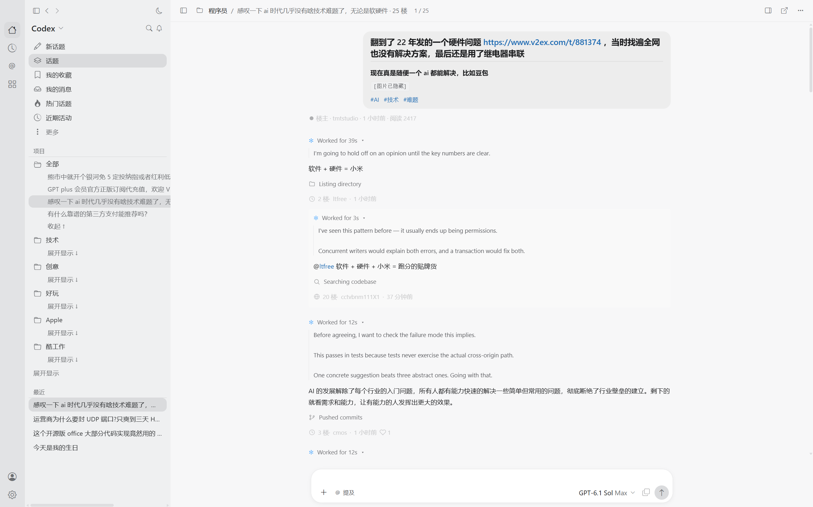
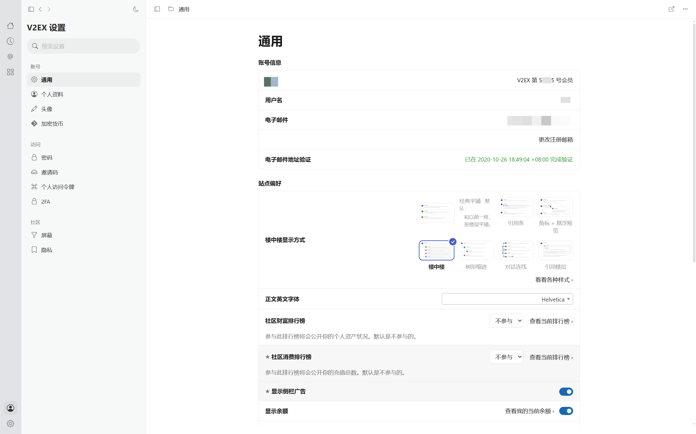

# V2EX · Codex 桌面皮肤

把 V2EX 的首页、最新话题、节点、帖子详情、发帖页和账户设置排成 Codex 风格的工作区。左侧的工具栏和项目栏对应分区。宽屏下开启 `lib.rs` 代码面板后，阅读区和代码面板等宽。皮肤默认使用浅色，可在皮肤设置中切换深色或跟随系统。

从列表打开话题时，当前列表会显示到详情页的皮肤准备好，再在同一标签页切换。

## 界面预览

### 帖子详情



### 账户设置



## 安装

1. 在浏览器安装脚本管理器。[Tampermonkey](https://www.tampermonkey.net/)
2. 在 Tampermonkey 中新建脚本，粘贴生成文件的全部内容并保存。[v2ex-codex.user.js](dist/v2ex-codex.user.js)
3. 打开或刷新 [V2EX](https://www.v2ex.com/)，首页默认显示「全部」。右上角的外链按钮可以在新标签页用原站布局打开当前页面。`settings.json` 也可以在当前标签页切回原站。

如果 Chrome 更新脚本后仍先显示原站，可在 Tampermonkey 的高级设置中将 `Content Script API` 设为 `UserScripts API Dynamic`，启用文档开始时立即注入。[Tampermonkey 文档](https://www.tampermonkey.net/documentation.php?locale=en&q=content_script_api)

双击 [preview.html](dist/preview.html) 可以离线体验，预览使用示例帖子。

## 使用

帖子详情直接显示当前页所有回帖。长帖通过 V2EX 的分页链接翻页。话题标签以 `#标签名` 链接显示在楼主正文末尾。每楼沿用 Linux.do 脚本的可折叠 `Worked for` 思考块和活动行样式。模拟文案、命令和耗时按楼层生成，刷新后保持一致。正文和回复中的图片默认折叠，可在皮肤设置中开启 `Images`。回复沿用 V2EX 的登录和提交机制。

发帖页在中间编辑标题，在底部选择节点并输入正文。`+` 菜单可通过站内图库上传图片，也可将 TXT 或 Markdown 导入正文。

左下角的账号图标打开账户设置。可在侧栏搜索分类，右侧的表单和操作沿用原站功能。

## 快捷键

| 按键 | 操作 |
| --- | --- |
| `K` / `J` | 选择下一帖 / 上一帖。从列表打开帖子后也可按原列表顺序切换。 |
| `Enter` | 打开选中的帖子。 |
| `V` | 扩大阅读区域。再按一次或按 `Esc` 返回。 |
| `Ctrl+Enter` / `⌘+Enter` | 发送回复，或将列表页草稿带到发帖页。 |
| `C` | 复制选中或正在阅读的原帖链接。 |
| `B` | 切换到 `lib.rs` 代码工作区。再按一次继续阅读。 |
| `Ctrl+K` / `⌘+K` | 搜索当前列表的话题和分区，或搜索账户设置分类。 |

## 构建

在项目目录运行以下命令。生成的用户脚本和离线预览位于 `dist`。

```powershell
npm.cmd ci
npm.cmd run build
```

界面参考了 `linuxdo-codex.user.js` 中的布局。内嵌字体和图标的许可随构建产物提供。[Inter](https://rsms.me/inter/) · [Bootstrap Icons](https://icons.getbootstrap.com/)
